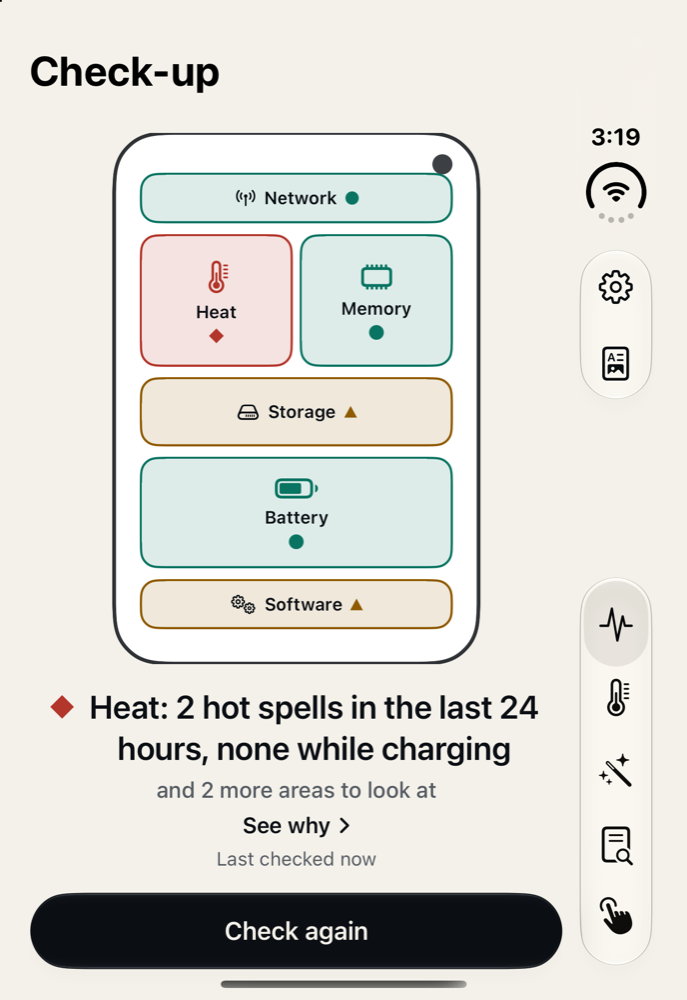
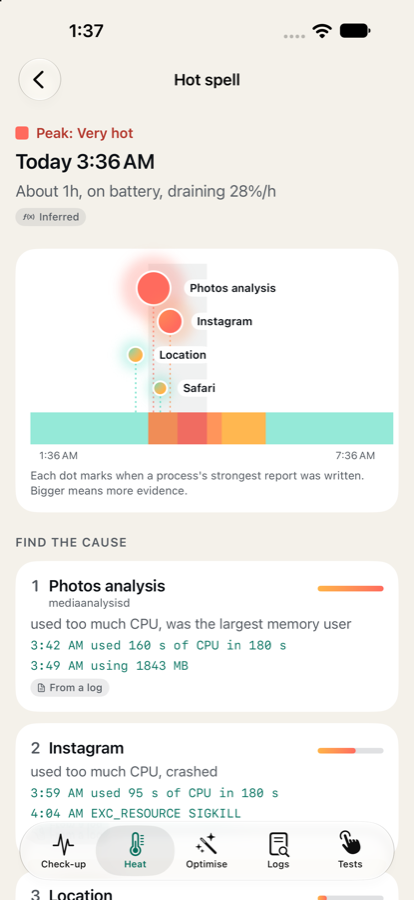
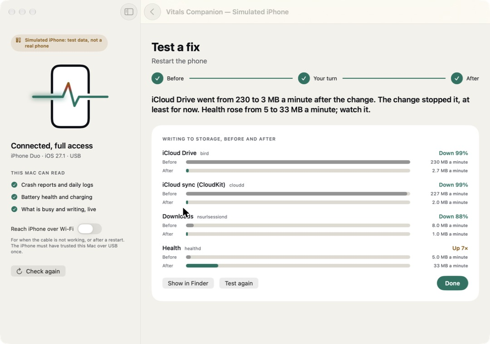
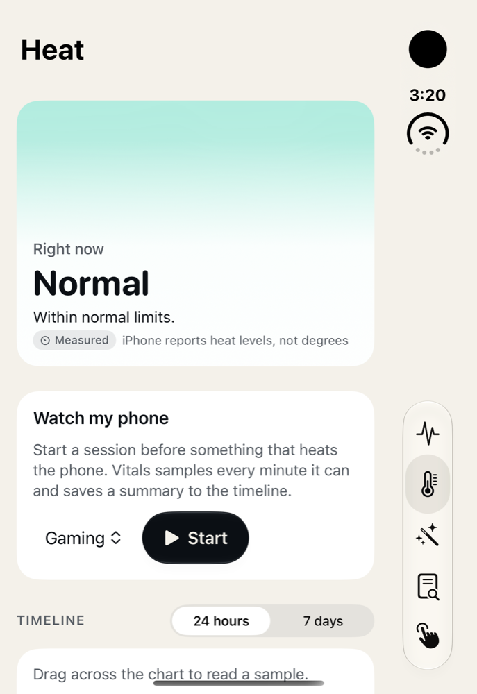
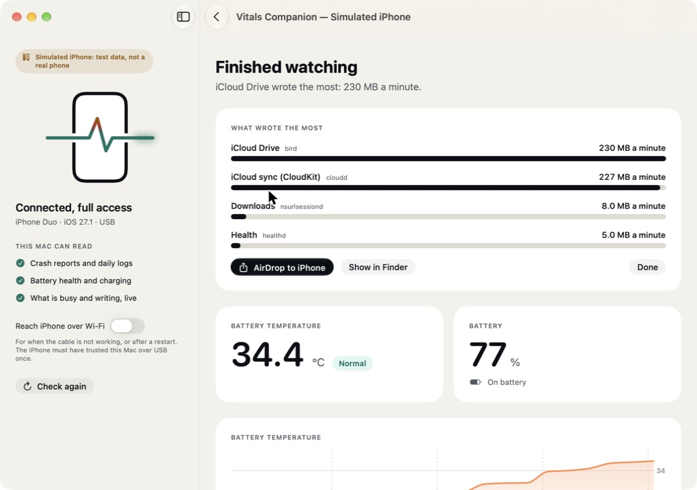

# Vitals

Vitals is a free check-up for your iPhone. It tells you, in plain words, why your phone is running hot or
draining fast, and what to do about it.

Everything happens on your phone. There is no account, no tracking and no server.

**[Get it free on the App Store](https://apps.apple.com/app/id6835033082)**

<p>
  
  
  
</p>

- [For anyone with a hot or draining iPhone](#for-anyone-with-a-hot-or-draining-iphone)
- [For repair technicians and engineers](#for-repair-technicians-and-engineers)
- [For contributors](#for-contributors)
- [Privacy](#privacy)
- [Support](#support)
- [Licence](#licence)

---

## For anyone with a hot or draining iPhone

### What Vitals does

- **Check-up.** Looks at heat, battery, storage, memory, network and software, and gives each one a status
  with one sentence. The worst one is named first, with a button to see why.
- **Heat.** Keeps a timeline of how warm the phone has been and finds "hot spells". When you share the
  daily file iOS keeps, it shows which apps were busy during each one.
- **What to do.** Every finding comes with one to three steps, the exact Settings path, and what each step
  costs you. Mark a step as done and Vitals measures whether it helped.
- **Relief.** Quick things that help now: clean up duplicate photos and old screen recordings, turn on Low
  Power Mode in one tap, or restart. There is no "clear RAM" button, because iOS gives apps no such power.
- **Tests.** Check the touch screen, speakers, cameras, buttons and sensors yourself.

### What it can and cannot tell you

Apple lets apps see some things and not others. Vitals says which is which.

| Vitals can tell you | Vitals cannot tell you, and why |
|---|---|
| The phone's heat **level** (normal, warm, hot, very hot) | The temperature in degrees. iPhone gives apps levels only. |
| Battery level and charging, from the phone | Battery use per app. Only Settings > Battery has it. Vitals can read a screenshot of that screen if you share one. |
| Which apps were busy, from the daily file iOS writes | Which app is busy **right now**. Apps cannot see other apps. A Mac can (see Vitals Companion below). |
| Storage, memory, network, software version | Battery health (maximum capacity). It is only in Settings > Battery > Battery Health. You can type it in. |

Every number carries a tag: **Measured** (read from iOS just now), **From a log** (from a file you shared)
or **Inferred** (worked out by Vitals).



### How to get it

- **App Store:** [Vitals: Phone Check-up](https://apps.apple.com/app/id6835033082), free, for iPhone with
  iOS 18 or later.
- **Build it yourself:** you need a Mac with Xcode 27.2 or later. See [For contributors](#for-contributors).

### Your first check-up

1. **Open Vitals and tap Run check-up.** Each part of the phone drawing lights up as it is checked. The
   verdict at the bottom names anything worth a look.
2. **Tap the part that is not green** (or "See why"). You get the readings, where each came from, and what
   to do.
3. **Turn on the daily file.** In Settings > Privacy & Security > Analytics & Improvements, turn on
   *Share iPhone Analytics*. iOS then writes one file each morning. (Apple also receives this data while
   the setting is on. You can turn it off again at any time.)
4. **Share that file with Vitals.** Next morning, go to Settings > Privacy & Security > Analytics &
   Improvements > Analytics Data, open the newest file that starts with *Analytics-*, tap Share, and choose
   Vitals. In Vitals, *Logs > Show me how* walks you through it.
5. **Look at Heat.** Your hot spells now show the apps that were busy at the time. Follow the steps under
   "What to do", then check again tomorrow to see if it helped.

---

## For repair technicians and engineers

### Hardware tests

The Tests tab has 15 guided tests (17 on iPhone Duo): touch grid, display, speakers, microphones, cameras,
haptics, buttons, motion sensors, proximity, Face ID, Bluetooth, Wi-Fi and cellular, GPS, NFC and flashlight,
plus both displays and the hinge on iPhone Duo. Automatic tests suggest a result; you confirm pass or fail.
Camera photos and microphone recordings are never saved.

### The report

*Check-up > Report* builds a **PDF** for people and a **JSON** file for tools. Both include the verdict,
every reading with its source, hot spells, findings, what was tried and whether it helped, and test results.
Personal details are **redacted by default** (device name, serial numbers and identifiers, app names, network
names); you can switch each one back on before sharing. The JSON format is documented in
[`Docs/report-schema.md`](Docs/report-schema.md).

### Vitals Companion (Mac)

An iPhone app cannot see other apps. A Mac connected by cable can. Vitals Companion is a separate Mac app in
[`companion/`](companion/) that reads more and hands the result back to the phone.



What it can read depends on the phone's settings. It says which level you have, and never asks you to change
it:

| Level | What it adds |
|---|---|
| **Phone only** | Everything above. |
| **Mac, no Developer Mode** | Every crash report and daily log in one go, and the battery's own data (cycle count, design and full-charge capacity, charger watts). |
| **Mac with Developer Mode** | Live: which processes are busy and how fast they write to storage, and **Test a fix**, which measures before and after a change (for example a restart) and tells you whether it helped. |

*Developer Mode* is an iPhone setting (Settings > Privacy & Security) meant for app developers. It lowers some
protections, so only turn it on when you need live readings, and turn it off afterwards.

The Mac app removes the phone's serial number and UDID (its unique device ID) from everything it saves.
It will be a direct download, not on the Mac App Store, and will bundle everything it needs (coming).

---

## For contributors

### Requirements

- macOS with **Xcode 27.2** or later (iOS 27 SDK, Swift 6).
- **[XcodeGen](https://github.com/yonaskolb/XcodeGen)** to generate the Xcode project from `project.yml`.
- **Python 3.9+** for the Mac companion's engine and its tests.

### Build and test

```bash
xcodegen generate                                   # creates Vitals.xcodeproj
open Vitals.xcodeproj                               # scheme "Vitals" (iPhone), "VitalsCompanion" (Mac)
cd Packages/VitalsKit && swift test                 # app logic tests
cd companion/engine && PYTHONPATH=. python3 -m unittest discover -s tests   # Mac engine tests
```

To run on your own iPhone, set your team in `project.yml` (`DEVELOPMENT_TEAM`) and change the bundle ids
(`sg.com.vitals.*`) and the app group (`group.sg.com.vitals.app`) to ones you own, then run `xcodegen generate`.

The Relief shortcuts are built from Python source in [`shortcuts/`](shortcuts/); see its README.

### Repository layout

| Folder | What is in it |
|---|---|
| `App/` | The iPhone app (SwiftUI screens, services, resources) |
| `Packages/VitalsKit/` | All logic (`VitalsKit`) and the design system (`VitalsDesign`), with tests |
| `Widgets/`, `ShareExtension/`, `Shared/` | Widgets, Control Center control and Live Activity; the "Share to Vitals" extension; code both use |
| `companion/` | The Mac app and its Python engine (GPL-3.0) |
| `shortcuts/` | Source for the Relief shortcuts |
| `Docs/` | Milestone notes, the report schema, what still needs a real phone, store drafts, screenshots |
| `scripts/` | Simulator helper and asset scripts |
| `PLAN.md` | The product and engineering plan |

### Simulator launch arguments

The simulator cannot get hot or run low on battery, so the app accepts launch arguments for testing. Add
them in Xcode under *Product > Scheme > Edit Scheme > Run > Arguments*, or pass them to
`xcrun simctl launch <device> sg.com.vitals.app <arguments>`.

| Argument | Effect |
|---|---|
| `-inject hot` (or `critical`, `warm`, `healthy`, `lowStorage`, `lowBattery`, `offline`) | Pretend readings. Every screen says "Injected values"; they never go into reports or widgets. |
| `-syntheticDay` | A made-up day of heat and battery samples, labelled as such. |
| `-syntheticLogs` | Made-up log files, so Logs and hot-spell causes have something to show. |
| `-skipOnboarding` | Skip the first-run pages. |
| `-reduceMotion` | Use the still versions of every animation. |
| `-live` | Clear any saved injected values. |

Deep links also work: `vitals://scan`, `vitals://heat`, `vitals://logs`, `vitals://optimise`,
`vitals://relief`, `vitals://tests`.

### Contributing

See [CONTRIBUTING.md](CONTRIBUTING.md). Third-party code and tools are listed in
[THIRD-PARTY-NOTICES.md](THIRD-PARTY-NOTICES.md).

---

## Privacy

**Vitals collects no data.**

- Everything Vitals reads stays on your phone: readings, the heat timeline, files you share into it,
  test results and reports. Nothing is sent to us or anyone else. There is no account and no analytics.
- Vitals reads system files only when **you** share them into it.
- **Photos:** only if you open Relief > Photos and videos clean-up. Your library is looked at on the phone;
  nothing is copied out. Deleting always goes through the iPhone's own confirmation, into Recently Deleted.
- **Camera, microphone, Bluetooth, location, motion, Face ID and NFC** are used only during the hardware test
  you start. Photos and recordings are shown once and never saved; only the result is kept (pass or fail,
  and for some tests a count, such as Bluetooth devices seen, or a GPS accuracy).
- **The one network use** is the network speed test, and only when you start it. It downloads about 25 MB and
  uploads about 5 MB of test data to Cloudflare's public speed-test service (speed.cloudflare.com). Nothing
  about you or the phone is sent, apart from what any internet connection reveals, such as your IP address.
- Reports leave the phone only if you share them, with personal details removed by default.
- The Mac companion works on your Mac only and removes device identifiers from what it saves.

## Support

Questions, problems and ideas: please open an issue on this project's GitHub page (Issues tab).
Include the JSON report if you can; it is redacted by default.

## Licence

All of Vitals is **GPL-3.0-or-later** ([LICENSE](LICENSE)): the iPhone app, widgets, share extension,
VitalsKit, the shortcuts and the Mac companion. You may use, study, change and share it. If you distribute
a changed version, you must publish its source under the same licence.

- The Mac companion in `companion/` has its own copy of the licence ([companion/LICENSE](companion/LICENSE)).
  It runs [pymobiledevice3](https://github.com/doronz88/pymobiledevice3), which is GPL-3.0. The iPhone app
  contains none of its code; the two only share a file format.
- Versions published before 19 November 2026 (up to commit `20a599b`) were released under the MIT licence,
  and copies of those stay under MIT.
- The names "Vitals" and "Vitals: Phone Check-up", the app icon and the App Store artwork are not covered by
  the licence. Please use your own name and icon for a fork.
